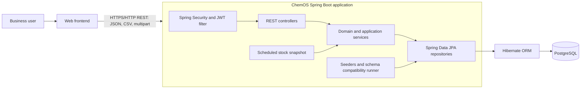

# ChemOS Backend: Technical Architecture

ChemOS is a Java 21, Spring Boot REST API for sales, purchasing, inventory, operational reference data, CSV-based financial data, and user/permission management. It is currently implemented as a single deployable Spring Boot application backed by PostgreSQL. The architecture below reflects the checked-in source and deployment configuration.

Security findings and prioritized hardening requirements are documented in [readme/SECURITY_HARDENING.md](readme/SECURITY_HARDENING.md).

## System Context

The backend exposes versioned HTTP APIs consumed by a separate frontend. JSON is the normal request/response format; CSV and multipart file upload are used by import/export endpoints. The application and its scheduled jobs share one relational database.



The application is a modular monolith, not a collection of independently deployed services. Authentication, sales, purchases, inventory, reporting, and reference data run in the same JVM and share the same database connection pool and deployment lifecycle.

## Runtime Architecture

The main runtime path is:

```mermaid
sequenceDiagram
  participant Client as Frontend
  participant Filter as JWT filter / Spring Security
  participant Controller as REST controller
  participant Service as Application service
  participant Repo as Spring Data repository
  participant DB as PostgreSQL
  Client->>Filter: HTTP request + Bearer token
  Filter->>Filter: Validate full-stage JWT; load active user and effective permissions
  Filter->>Controller: Establish authenticated SecurityContext
  Controller->>Controller: Check endpoint permission (@PreAuthorize)
  Controller->>Service: Validate/dispatch use case
  Service->>Repo: Read or write within transaction
  Repo->>DB: Hibernate/JPA query
  DB-->>Repo: Rows / update result
  Repo-->>Service: Entities or projections
  Service-->>Controller: Result / mapped response
  Controller-->>Client: HTTP status and JSON / CSV
```

For a request without a full access token, security rejects protected routes with `401`. An authenticated user lacking the endpoint's permission receives `403`. Authentication and endpoint permissions are enforced on the backend; frontend permission data is only suitable for driving interface visibility.

## Application Structure

| Package | Responsibility |
| --- | --- |
| `chemos.chem_os.controller` | HTTP boundary for domain APIs: request parameters, payloads, status/response construction, file transfers, and permission annotations. |
| `chemos.chem_os.services` | Business use cases and transaction boundaries for sales, purchases, links, stock, reference data, CSV imports, audit events, and current-user context. |
| `chemos.chem_os.repository` | Spring Data JPA repositories and domain-specific queries/projections. |
| `chemos.chem_os.model` | JPA entities representing transactions, inventory, reference data, uploads, stock snapshots, and audit records. |
| `chemos.chem_os.dto` | Request/response records and transfer shapes used by API operations. |
| `chemos.chem_os.mapper` | Entity/DTO conversions for selected domains, including sales, purchases, company, product, port, and other reference data. |
| `chemos.chem_os.auth.controller` | Login, 2FA, user administration, role listing, and permission override endpoints under `/api/v1/auth`. |
| `chemos.chem_os.auth.service` | Password authentication, TOTP and backup-code workflows, permission resolution, and user/override management. |
| `chemos.chem_os.auth.security` | Stateless security configuration, JWT issue/validation, request authentication, TOTP-secret encryption, and login rate limiting. |
| `chemos.chem_os.auth.model` / `repository` | JPA entities and repositories for users, roles, permissions, per-user restrictions, TOTP credentials, and backup codes. |
| `chemos.chem_os.auth.config` | Permission/admin seeding and a startup compatibility migration for sale-purchase-link schema changes. |

The Spring Boot entry point is `ChemOsApplication`. It enables component scanning, auto-configuration, and scheduling. Controllers depend on services rather than accessing repositories directly; services coordinate persistence and cross-cutting operations such as audit logging.

## Business Domains and API Surface

The principal REST resource groups are:

| Domain | API base path | Main responsibilities |
| --- | --- | --- |
| Authentication and administration | `/api/v1/auth` | Password challenge, 2FA enrollment/verification/recovery, current-user permissions, user lifecycle, and roles. Permission overrides are under `/api/v1/auth/users/{username}/permission-overrides`. |
| Sales | `/api/v1/sales` | Create/read/update, confirm/cancel, lifted quantity, filtering, CSV import/export, and summaries. |
| Purchases | `/api/v1/purchase` | Purchase orders, confirmation/cancellation, receipt updates, physical-stock workflows, and export. |
| Sale-purchase links | `/api/v1/links` | Link sale and purchase quantities, list links by user or transaction, and track negative-link history. |
| Inventory and stock analytics | `/api/v1/stock-stats` plus purchase physical-stock routes | Vessel/product/port stock views, summaries, history, and daily incoming-unsold snapshots. |
| Reference data | `/api/v1/companies`, `/products`, `/ports`, `/countries`, `/payment-terms`, `/market-status`, `/transit-days`, `/salespersons` | Search, suggestions, and maintenance of business lookup data. |
| Financial uploads and audit | `/api/v1/cost-csv`, `/revenue-csv`, `/pl`, `/api/v1/audit` | Upload and query cost, revenue, and P&L rows; inspect audit events. |

The domain model uses `Sales` and `Purchase` as core transaction records, connected by `SalePurchaseLink`. Inventory-related records include physical and dump stock and `IncomingUnsoldSnapshot`. Supporting entities hold products, companies, ports, countries, payment terms, market status, and salespeople. CSV upload metadata and imported entries are persisted separately from the transactional records. JPA associations are used for several references (for example, product, port, status, and salesperson), while some legacy business values remain represented as strings; the model is therefore not uniformly normalized.

## Authentication and Authorization

The security configuration is stateless: CSRF, form login, and HTTP Basic are disabled; the JWT filter runs before the standard username/password filter. Login uses a two-stage flow:

1. `POST /api/v1/auth/login` verifies the password and returns a short-lived pre-auth challenge token, not a normal API access token.
2. The client either initializes and confirms TOTP enrollment or verifies a TOTP/backup code. Successful completion issues a full-stage signed JWT. TOTP secrets are encrypted for storage; backup codes are stored as hashes and consumed once.

For each full-token request, `JwtAuthFilter` validates the token, reloads the active user and role/permission data, resolves effective permission codes, and installs them as Spring Security authorities. A role's own permissions and (where configured) its direct non-super parent role's permissions are combined with per-user `ALLOW` restrictions; `DENY` restrictions are applied last. A super role receives every defined permission. Controllers enforce these codes with `@PreAuthorize`. Some services additionally apply record-ownership scoping for roles marked as restricted; this is separate from endpoint-level permission checks.

Passwords use BCrypt. The JWT service signs tokens with HS256 and sets a 24-hour full-token lifetime. Login and 2FA failure/lockout behavior is implemented in the security/auth services. CORS is allow-listed in `SecurityConfig`; update that list when frontend origins change.

## Persistence and Background Work

Spring Data JPA and Hibernate provide ORM and repository access to PostgreSQL. Service methods use Spring transaction annotations for multi-step writes and read-only operations. Apache Commons CSV is used for CSV parsing; Jackson handles JSON and Java time serialization. Actuator exposes health and info endpoints for deployment checks.

The application enables scheduling. `VesselStockStatsService` runs a transactional job at 00:30 Asia/Kolkata each day to calculate and persist the previous day's incoming-unsold snapshot, then records an audit event. This job runs inside each application instance; the current deployment is configured as one service process per environment, so horizontal scaling would require a single-run/leader-election strategy to prevent duplicate scheduling.

On startup, `DataSeeder` idempotently seeds permission definitions, the super-admin role, and an initial admin user if absent. `SalePurchaseLinkSchemaMigration` checks and adds selected compatibility columns/table using `JdbcTemplate`. These startup actions are in addition to Hibernate schema handling.

## Configuration and Deployment

| Runtime | Port | Database/schema behavior | Configuration source |
| --- | ---: | --- | --- |
| Default | `8081` | `ddl-auto=update` | `application.properties` |
| Development | `8082` | `ddl-auto=update` | `application-dev.properties` with `DB_URL`, `DB_USERNAME`, `DB_PASSWORD`, JWT and TOTP keys from environment. |
| Production | `8083` | `ddl-auto=validate` | `application-prod.properties` with the same secrets and DB settings supplied from environment. |

Local `docker-compose.yml` starts PostgreSQL 17 only; it does not containerize the API. Ensure the active Spring profile and database URL target that local database when using Compose. Production schema changes are not automatically created by Hibernate: `sql/2fa_schema.sql` documents the 2FA tables that must exist for production validation. There is no Flyway or Liquibase dependency in the Maven manifest, so schema evolution currently relies on Hibernate in update-mode environments, explicit SQL, and the targeted startup compatibility runner.

The GitHub Actions workflows build a Java 21 Maven JAR on pushes to `development` and `main`, copy the JAR/configuration to EC2 over SSH, invoke the environment's deployment script, and check `/actuator/health`. The workflows currently use `mvn clean package -DskipTests`; they do not gate deployment on the test suite. Development and production use separate service directories/profiles and ports, with systemd unit files checked in under `scripts/`.

**Configuration security:** the checked-in default `application.properties` currently contains hard-coded database and cryptographic configuration. Treat those values as exposed, rotate them if they are real, and move secrets to environment variables or a secret manager. Do not copy secrets into this documentation. The development/production profiles and deployment workflows already use environment variables for these settings.

## Build and Tests

Requirements: Java 21 and Maven (or the included Maven wrapper). Build with `./mvnw clean package` on Unix-like shells or `mvnw.cmd clean package` on Windows. Tests are under `src/test/java`; current focused coverage includes authentication, 2FA, TOTP-secret encryption, and login rate limiting, plus the Spring application context test. Run the full suite with `./mvnw test` or `mvnw.cmd test` before release; the deployment workflows currently skip it.

## Architecture Notes and Constraints

- The backend is a single-process modular monolith with a shared PostgreSQL schema; there are no separately deployed domain services or frontend assets in this repository.
- Authorization is permission-code based and refreshed from the database during JWT authentication, rather than trusting a role claim as the complete permission set.
- Database migration ownership is split across Hibernate, startup JDBC compatibility logic, and manually applied SQL. Production releases that add/change schema must coordinate those steps before application rollout.
- Scheduled snapshot work has no distributed lock in the application code. Keep one active instance per environment until scheduling is made cluster-safe.
- The current CI deployment workflows build but skip tests. Treat the local Maven test command as a required release check until the pipeline is updated.

---

# ChemOS Auth + 2FA — Frontend Integration Guide

This document covers everything needed to integrate the login/2FA flow,
user management (create/list/edit/get/deactivate), and role-driven UI
visibility (including restricting the dashboard to admins). All endpoints
live under `AuthController`
(`src/main/java/chemos/chem_os/auth/controller/AuthController.java`), base
path `/api/v1/auth`.

## Base URLs


CORS is already configured to allow `http://localhost:3000`,
`http://localhost:5173`, `http://35.154.133.62:3000` and

origin/port, the backend team needs to add it to `SecurityConfig.java`
before your requests will succeed.

## The big picture: login is two steps, always

There is no single "login" call that returns a usable token. Every login
goes through **two requests**:

1. **`POST /login`** — username + password only. Never returns an access
   token. It returns a short-lived `preAuthToken` and tells you whether the
   user needs to **enroll** in 2FA (first time) or **verify** an existing
   2FA code.
2. Depending on the `status` from step 1, either:
   - **`POST /2fa/enroll/init`** → **`POST /2fa/enroll/confirm`** (first-time
     setup), or
   - **`POST /2fa/login/verify`** (already enrolled)

   Both of these use the `preAuthToken` as a Bearer token and, on success,
   return the **real** access token (`token` field) you use for every other
   API call.

```
POST /login (username, password)
        │
        ▼
  status = "ENROLLMENT_REQUIRED"          status = "VERIFICATION_REQUIRED"
        │                                          │
        ▼                                          ▼
POST /2fa/enroll/init (Bearer preAuthToken)  POST /2fa/login/verify
        │                                     (Bearer preAuthToken, code)
        ▼                                          │
POST /2fa/enroll/confirm                           │
 (Bearer preAuthToken, code)                       │
        │                                          │
        ▼                                          ▼
   real access token  ◄─────────────────────────────
        │
        ▼
  store token, use as
  "Authorization: Bearer <token>"
  on every subsequent request
```

**Important:** the `preAuthToken` only works on the `/2fa/**` endpoints. It
carries no permissions — do not store it as if it were a session token, and
do not send it as the `Authorization` header for any other API call.

---

## Step 1 — `POST /login`

**Request**
```json
{
  "username": "jdoe",
  "password": "correct-horse-battery-staple"
}
```

**Response `200 OK`**
```json
{
  "status": "ENROLLMENT_REQUIRED",
  "preAuthToken": "eyJhbGciOi...",
  "username": "jdoe"
}
```
`status` is one of:
- `"ENROLLMENT_REQUIRED"` — this user has no 2FA set up yet → go to
  **Step 2A**.
- `"VERIFICATION_REQUIRED"` — this user already has 2FA enabled → go to
  **Step 2B**.

**Errors**
- `401 Unauthorized` — wrong username/password, or account disabled.
- `429 Too Many Requests` — too many failed attempts for this username
  (5 failures locks it out for 15 minutes). Show the message to the user
  and don't let them retry immediately.

---

## Step 2A — First-time setup (`ENROLLMENT_REQUIRED`)

### `POST /2fa/enroll/init`
Header: `Authorization: Bearer <preAuthToken>`
No request body.

**Response `200 OK`**
```json
{
  "secretBase32": "JBSWY3DPEHPK3PXP",
  "otpauthUri": "otpauth://totp/ChemOS:jdoe?secret=JBSWY3DPEHPK3PXP&issuer=ChemOS&algorithm=SHA1&digits=6&period=30"
}
```
Render `otpauthUri` as a QR code (e.g. with `qrcode.react` or any
`otpauth://` QR library) for the user to scan with Google
Authenticator / Authy / 1Password, etc. Also show `secretBase32` as
selectable text as a manual-entry fallback for users who can't scan a QR
code.

**Errors**
- `409 Conflict` — this user already has 2FA enabled (shouldn't happen if
  you only call this after `ENROLLMENT_REQUIRED`).

### `POST /2fa/enroll/confirm`
Header: `Authorization: Bearer <preAuthToken>`

**Request** — the 6-digit code currently shown in the user's authenticator
app, to prove they scanned the QR code correctly:
```json
{ "code": "123456" }
```

**Response `200 OK`**
```json
{
  "token": "eyJhbGciOi...",
  "username": "jdoe",
  "role": "SALES_MANAGER",
  "backupCodes": [
    "AB12-CD34", "EF56-GH78", "IJ90-KL12", "MN34-OP56", "QR78-ST90",
    "UV12-WX34", "YZ56-AB78", "CD90-EF12", "GH34-IJ56", "KL78-MN90"
  ]
}
```

**This is the only time `backupCodes` is ever returned.** Show them once,
in a screen the user can screenshot/print/copy (e.g. "Save these — you
won't see them again"), and make them explicitly acknowledge before
continuing. These are one-time recovery codes for when the user loses
their authenticator device — each one works exactly once, in place of a
6-digit code, at the `/2fa/login/verify` step.

`token` is the real access token — store it and proceed as logged in
(see **After login**, below).

**Errors**
- `400 Bad Request` — enrollment was never initiated (call `/enroll/init`
  first).
- `401 Unauthorized` — wrong code.
- `409 Conflict` — already enrolled.
- `429 Too Many Requests` — 5 wrong codes locks the account for 15 minutes.

---

## Step 2B — Returning user (`VERIFICATION_REQUIRED`)

### `POST /2fa/login/verify`
Header: `Authorization: Bearer <preAuthToken>`

**Request** — either a 6-digit authenticator code, or one of the user's
remaining backup codes (case-insensitive):
```json
{ "code": "123456" }
```
or
```json
{ "code": "ab12-cd34" }
```

**Response `200 OK`**
```json
{
  "token": "eyJhbGciOi...",
  "username": "jdoe",
  "role": "SALES_MANAGER"
}
```
Store `token` — this is the real access token.

**Errors**
- `400 Bad Request` — this user isn't enrolled in 2FA at all (shouldn't
  happen if you followed `status` from Step 1 correctly).
- `401 Unauthorized` — wrong code, or (if a 6-digit code) the *same* code
  was already used in the last 90 seconds — tell the user to wait for
  their app to generate a new code.
- `429 Too Many Requests` — 5 wrong codes locks the account for 15 minutes.
  If the user is out of options, they need an admin to unlock or reset
  their 2FA (see below).

Each backup code works once. Consider showing a warning in your UI once a
user is down to their last couple of backup codes — you can check this
via the admin status endpoint below, or just track "this was the last one
that worked" client-side if you ever expose that count in your own UI.

---

## After login — using the access token

Every other API call (everything not under `/auth/login` or `/auth/2fa/**`)
requires:
```
Authorization: Bearer <token>
```
The token is valid for 24 hours. There is currently no refresh-token flow —
when it expires, calls will start returning `401 Unauthorized` and the user
needs to log in again from Step 1.

### `GET /me`
Header: `Authorization: Bearer <token>`

Call this right after login to get the user's permissions and drive your
UI (which nav items/buttons/routes to show). **This is a UX convenience,
not your security boundary** — the backend enforces permissions
server-side on every endpoint regardless of what this returns, so don't
skip real error handling on `403` responses just because you checked this.

**Response `200 OK`**
```json
{
  "user": {
    "username": "jdoe",
    "name": "Jane Doe",
    "role": "SALES_MANAGER",
    "roleDisplayName": "Sales Manager"
  },
  "permissions": ["SALE_VIEW", "SALE_CREATE", "PURCHASE_VIEW", "..."],
  "modules": {
    "sales":     { "canView": true, "canCreate": true, "canEdit": false, "canApprove": false },
    "purchases": { "canView": true, "canCreate": false, "canEdit": false, "canApprove": false },
    "company":   { "canView": true, "canCreate": false, "canEdit": false, "canApprove": false },
    "products":  { "canView": true, "canCreate": false, "canEdit": false, "canApprove": false },
    "dashboardVisible": false
  }
}
```

`modules.dashboardVisible` is `true` only for users whose role carries the
`DASHBOARD_VIEW` permission — by default that's just `ADMIN` (it's a
super-role, so it always gets every permission). No other role has it
unless an admin explicitly grants it via role management. **Use this flag
to hide the dashboard nav item/route for everyone else.** As with every
other flag on this endpoint, it's a UX convenience — if a dashboard *data*
endpoint gets added on the backend later, it will enforce this
server-side too, so don't rely on hiding the link alone.

---

## User management (admin/manager screens)

All endpoints below require the caller's token to carry the
`USER_MANAGEMENT` permission (typically `ADMIN`, but any role that's been
granted it — e.g. a "manager" role — can use these too). No request body
ever returns a password — passwords are one-way hashed and are never
retrievable, by design.

### `POST /users` — create a user
```json
// Request
{
  "username": "jdoe",
  "password": "temporary-password-123",
  "roleId": "sales_manager",
  "name": "Jane Doe",
  "email": "jane@example.com"
}
```
```json
// Response 200 OK
{
  "id": "3f2e9b1a-...-uuid",
  "username": "jdoe",
  "isActive": true,
  "name": "Jane Doe",
  "email": "jane@example.com",
  "role": "SALES_MANAGER",
  "roleDisplay": "Sales Manager",
  "permissions": ["SALE_VIEW", "SALE_CREATE", "..."]
}
```
The password you send here is the one and only time it exists in plain
text on the wire — show it to the admin/manager in their own UI if you
want them to note it down (e.g. right after this call succeeds), but it
is never returned again by any endpoint afterward.

### `GET /users` — list all users
Returns an array of the same `UserResponse` shape as above (no password
field — it's never included). Use this to render your users table,
including the `name`/`email` columns.

### `GET /users/{id}` — get one user's details
Path param is the user's `id` (UUID, from the list response). Returns the
same `UserResponse` shape. Use this to populate an edit-user form.

### `PATCH /users/{username}` — edit a user's details
Path param here is `username` (not `id`).
```json
// Request — newPassword is optional
{
  "roleId": "sales_manager",
  "name": "Jane A. Doe",
  "email": "jane.doe@example.com",
  "newPassword": "only-send-this-if-resetting-it"
}
```
Returns the updated `UserResponse`. Omit `newPassword` (or send `null`)
to leave the existing password untouched — this is how a manager "resets"
a user's password without ever being able to see the current one: she
types a brand-new one here, which becomes the user's password going
forward. If you send it, it must be at least 6 characters (`400 Bad
Request` otherwise).

### `PATCH /users/{username}/toggle` — activate/deactivate a user
No body. Flips `isActive`. A deactivated user can't log in
(`401 Unauthorized` at `/login`). Returns the updated `UserResponse`.

### `GET /roles` — list roles (for populating a role dropdown)
```json
[
  {
    "id": "sales_manager",
    "name": "SALES_MANAGER",
    "displayName": "Sales Manager",
    "isSuperRole": false,
    "parentRoleId": null,
    "permissions": ["SALE_VIEW", "SALE_CREATE", "SALE_EDIT"]
  }
]
```
Use `id` as the `roleId` value when creating/editing a user.

---

## Admin: managing a user's 2FA

These require the caller's own token to carry the `USER_MANAGEMENT`
permission (i.e. an admin is logged in and calling these, not the affected
user). Use them to build an admin screen for "user is locked out / lost
their phone."

All three take `Authorization: Bearer <token>` (a normal, full-permission
token) and a `username` path variable, no body:

| Method | Path | What it does |
|---|---|---|
| `GET` | `/users/{username}/2fa/status` | Check enrollment + lockout state |
| `PATCH` | `/users/{username}/2fa/unlock` | Clear a failed-attempt lockout, keep 2FA enrolled |
| `PATCH` | `/users/{username}/2fa/reset` | Wipe 2FA entirely — user re-enrolls (new QR code) on next login |

All three return the same shape:
```json
{
  "username": "jdoe",
  "totpEnabled": true,
  "backupCodesRemaining": 6
}
```
Use `reset` when a user has lost their authenticator device entirely (no
backup codes left either). Use `unlock` when they just fat-fingered the
code too many times and are temporarily locked out but still have their
device.

---

## Error response shape

Errors come back as a JSON body with the HTTP status code as the source of
truth. **Branch your error handling on the HTTP status code, not on
parsing message text** — treat any `message`/`error` field in the body as
a nice-to-have for displaying to the user, not something to pattern-match
on in code. Status codes you'll see from this API:

| Status | Meaning here |
|---|---|
| `401` | Bad credentials / bad code / expired or missing token |
| `403` | Valid token, but missing the permission required for this action |
| `404` | Resource not found (e.g. unknown username on an admin endpoint) |
| `409` | Conflict (e.g. trying to enroll 2FA twice) |
| `429` | Rate-limited / locked out — read the message, back off, don't retry immediately |

> Note for the backend team: confirm whether `server.error.include-message`
> needs to be set to `always` — several of these errors carry specific,
> user-facing reason text (e.g. "Account locked... try again in 12
> minutes") that's only useful to the frontend if it actually reaches the
> response body.

---

## Minimal example (fetch)

```js
async function login(username, password) {
  const res = await fetch(`${BASE_URL}/api/v1/auth/login`, {
    method: 'POST',
    headers: { 'Content-Type': 'application/json' },
    body: JSON.stringify({ username, password }),
  });
  if (!res.ok) throw await res.json().catch(() => ({ status: res.status }));
  return res.json(); // { status, preAuthToken, username }
}

async function verify2fa(preAuthToken, code) {
  const res = await fetch(`${BASE_URL}/api/v1/auth/2fa/login/verify`, {
    method: 'POST',
    headers: {
      'Content-Type': 'application/json',
      Authorization: `Bearer ${preAuthToken}`,
    },
    body: JSON.stringify({ code }),
  });
  if (!res.ok) throw await res.json().catch(() => ({ status: res.status }));
  return res.json(); // { token, username, role }
}

// After getting `token` back, store it and attach it to every future call:
async function authedFetch(path, options = {}) {
  return fetch(`${BASE_URL}${path}`, {
    ...options,
    headers: {
      ...options.headers,
      Authorization: `Bearer ${token}`,
    },
  });
}
```

## Where to store the token

Store `token` (and never `preAuthToken`, beyond the moment you use it) in
memory or `sessionStorage`/`localStorage` per your app's existing session
strategy — this backend doesn't set any cookies itself, so token storage
and attachment is entirely the frontend's responsibility.
